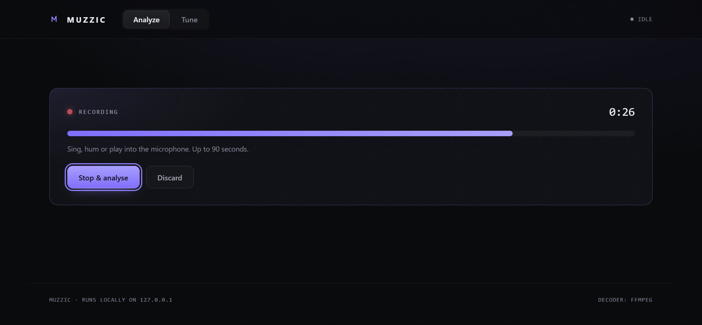

# MUZZIC

A local music workbench for dropping in a track — or recording one straight from the microphone — and getting its bones back: key and scale, tempo and meter, song structure, chord movement, a 16th-note drum grid with MIDI export, and a scored critique. A second tab turns the browser into a chromatic tuner.

No npm, no build step, no network calls. A Python standard-library HTTP server serves a static UI on loopback and runs the analysis engine behind two endpoints.





## What it does

**Analyze a track** — from a file or the microphone
- Key, scale and mode (Krumhansl-Schmuckler key finding with home-tone weighting)
- Tempo, meter, bar start and duration
- Structure ribbon (section boundaries over the track)
- Chord progression with roman numerals
- Timbre summary
- Drum pattern transcribed to a 16th-note grid per bar, with General MIDI drum export (`.mid`)
- Loudness measurement (FFmpeg `loudnorm`) folded into a weighted critique
- Ranked fixes plus strengths

**Record from the microphone**
- Capture a take in the browser, up to 90 seconds, then analyse it like any file
- Live input level meter; the recording is encoded to WAV on this machine and posted only to the local server

**Tune**
- Chromatic tuner driven by the microphone, with a needle meter
- Preset guitar tunings
- Piano keyboard for reference tones

## Requirements

- Python 3.10+
- `numpy`, `scipy`, `librosa`, `soundfile`, `mido` (see [requirements.txt](requirements.txt); the engine compiles numba kernels on first run)
- FFmpeg on `PATH` — optional. Without it, WAV/FLAC/OGG/AIFF still work and microphone takes still work; with it, MP3/M4A/AAC uploads and loudness measurement are available too.

## Quick start

### Windows

```bat
start.cmd
```

Or manually:

```bat
python -m venv .venv
.venv\Scripts\python -m pip install -r requirements.txt
.venv\Scripts\python server.py
```

### macOS / Linux

```sh
./start.sh
```

Or manually:

```sh
python3 -m venv .venv
.venv/bin/python -m pip install -r requirements.txt
.venv/bin/python server.py
```

The app opens at <http://127.0.0.1:8765/>. Both launchers create `.venv` on first run and reuse it afterwards.

### Docker (Linux, macOS, Windows)

```sh
docker compose up --build      # then open http://127.0.0.1:8765/
```

or without Compose:

```sh
docker build -t muzzic .
docker run --rm -p 8765:8765 muzzic
```

The image includes FFmpeg, so MP3/M4A uploads and loudness measurement work out of the box.

### FFmpeg (optional)

| OS | Command |
| --- | --- |
| Windows | `winget install Gyan.FFmpeg` |
| macOS | `brew install ffmpeg` |
| Debian/Ubuntu | `sudo apt install ffmpeg` |

The footer reports whether a decoder was found (`decoder: ffmpeg` / `decoder: built-in`).

## Run options

```sh
python server.py                    # http://127.0.0.1:8765/ and opens a browser
python server.py --port 9000 --no-browser
python server.py --host 0.0.0.0     # expose on a LAN (e.g. inside Docker)
python server.py --no-warm          # skip the one-time librosa warm-up (~10 s)
```

Microphone capture needs a secure context. `http://127.0.0.1` and `http://localhost` count as secure; a plain HTTP LAN address does not, so keep using localhost or put the app behind HTTPS.

## API

| Method | Path | Purpose |
| --- | --- | --- |
| `GET` | `/api/health` | Liveness plus whether FFmpeg was found |
| `POST` | `/api/analyze` | Body is raw audio bytes; headers `X-File-Name`, `X-Start`, `X-Seconds` |
| `GET` | `/api/midi/{id}` | Download the drum MIDI produced by an analysis |

Uploads are capped at 80 MB and analysis is limited to a 90-second excerpt by default, extracted with FFmpeg to mono 22.05 kHz so long files stay fast. Responses are sanitised to strict JSON (`NaN`/`Infinity` dropped) and every response is sent `Cache-Control: no-store`.

## Layout

```
server.py            HTTP server, upload handling, FFmpeg excerpt + loudness
engine/theory.py     key/scale/mode, chords, tempo, meter, structure, timbre
engine/drums.py      band-split drum transcription and MIDI export
engine/score.py      Nightshift taste scoring
engine/profile.json  the taste model: numeric windows and axis weights
public/index.html    UI shell: Analyze, record and Tune panels
public/app.js        upload, microphone capture, result rendering, MIDI download
public/tuner.js      microphone pitch detection for the tuner
public/app.css       styling
```

Edit `engine/profile.json` to change the taste targets or weights — the critique follows the numbers.

## Privacy

The server binds to `127.0.0.1` by default, analysis happens locally, and audio never leaves the machine. CORS is permissive so the page also works when opened straight from disk; the listener stays loopback-only unless you pass `--host`.

## License

MIT — see [LICENSE](LICENSE).