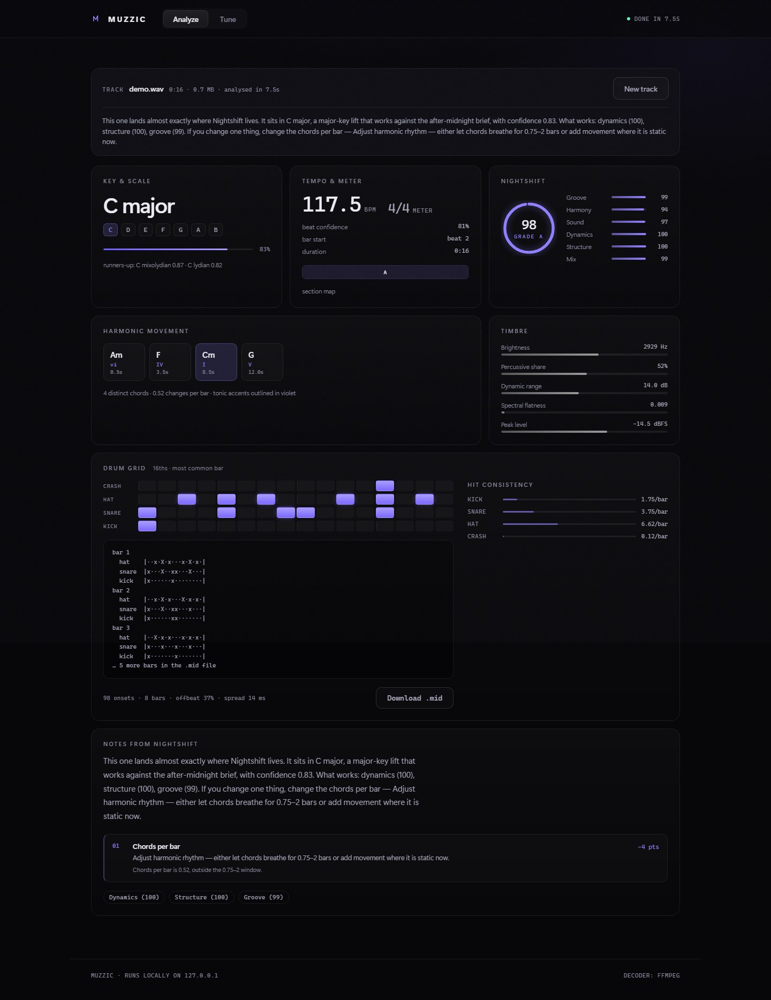
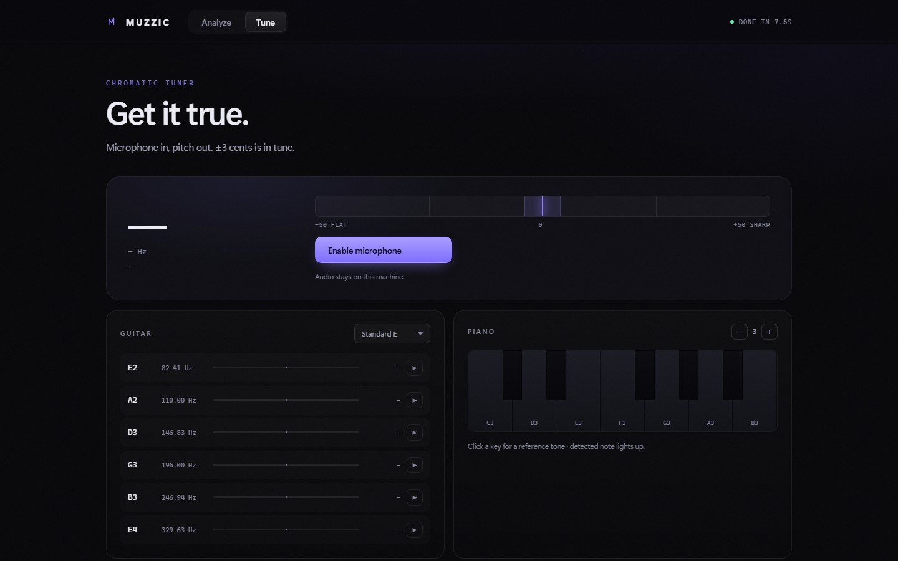

# MUZZIC

A local music workbench for dropping in a track and getting its bones back: key and scale, tempo and meter, song structure, chord movement, a 16th-note drum grid with MIDI export, and a scored critique. A second tab turns the browser into a chromatic tuner.

No npm, no build step, no network calls. A Python standard-library HTTP server serves a static UI on loopback and runs the analysis engine behind two endpoints.





## What it does

**Analyze a track**
- Key, scale and mode (Krumhansl-Schmuckler key finding with home-tone weighting)
- Tempo, meter, bar start and duration
- Structure ribbon (section boundaries over the track)
- Chord progression with roman numerals
- Timbre summary
- Drum pattern transcribed to a 16th-note grid per bar, with General MIDI drum export (`.mid`)
- Loudness measurement (FFmpeg `loudnorm`) folded into a weighted critique
- Ranked fixes plus strengths

**Tune**
- Chromatic tuner driven by the microphone, with a needle meter
- Preset guitar tunings
- Piano keyboard for reference tones

## Requirements

- Python 3.10+
- FFmpeg on `PATH` (optional: without it, analysis falls back to uncompressed sources)
- `numpy`, `soundfile`, `librosa` (the engine compiles numba kernels on first run)
- The analysis engine modules — `theory`, `drums` and `score`. They are loaded from
  `$MUZZIC_SKILLS` (default `~/.qoder/skills`) and are kept out of this repo:
  - `music-theory-analyze/scripts/theory.py`
  - `drum-transcribe/scripts/drums.py`
  - `music-taste-critic/scripts/score.py`

## Run

```bash
python server.py            # http://127.0.0.1:8765/ and opens a browser
python server.py --port 9000 --no-browser
python server.py --no-warm  # skip the one-time librosa warm-up (~10 s)
```

## API

| Method | Path | Purpose |
| --- | --- | --- |
| `GET` | `/api/health` | Liveness plus whether FFmpeg was found |
| `POST` | `/api/analyze` | Body is raw audio bytes; headers `X-File-Name`, `X-Start`, `X-Seconds` |
| `GET` | `/api/midi/{id}` | Download the drum MIDI produced by an analysis |

Uploads are capped at 80 MB and analysis is limited to a 90-second excerpt by default, extracted with FFmpeg to mono 22.05 kHz so long files stay fast. Responses are sanitised to strict JSON (`NaN`/`Infinity` dropped) and every response is sent `Cache-Control: no-store`.

## Layout

```
server.py          HTTP server, upload handling, FFmpeg excerpt + loudness
public/index.html  UI shell: Analyze and Tune panels
public/app.js      upload, polling, result rendering, MIDI download
public/tuner.js    microphone pitch detection for the tuner
public/app.css     styling
```

## Notes

- The server binds to `127.0.0.1` only.
- CORS is permissive because the page may also be opened straight from disk; the listener is loopback-only.
